# Web1Lab6: Laporan Praktikum 6 - DOM dan Event Handling JavaScript[cite: 1]

Repositori ini berisi hasil pengerjaan Praktikum 6 mata kuliah Pemrograman Web mengenai pengenalan manipulasi DOM (*Document Object Model*) dan *Event Handling* di JavaScript, meliputi pemilihan elemen HTML, penanganan berbagai *event* (`click`, `input`, `change`, `submit`), penggunaan `classList`, validasi formulir interaktif, aplikasi To-Do List, hingga eksperimen mandiri[cite: 1].

## Data Mahasiswa[cite: 1]
- **Nama:** Nurfaiz Pradibto Nugroho
- **NIM:** 312510172
- **Program Studi / Semester:** Teknik Informatika / 3
- **Kelas:** I253C
- **Mata Kuliah:** Pemrograman Web
- **Dosen Pengampu:** Agung Nugroho, S.Kom., M.Kom.
- **Hari / Tanggal:** Sabtu, 31 Oktober 2026 (Pertemuan 7 - Online)
- **Instansi:** Universitas Pelita Bangsa

---

## Langkah-langkah Praktikum

Berikut adalah alur pengerjaan Praktikum 6 beserta rincian kode dan tautan gambar bukti hasil praktikum:

### 1. Persiapan dan Struktur Dasar HTML/JS
- Mempersiapkan text editor (Visual Studio Code), membuat folder kerja `lab6_dom_event`, serta menyiapkan file `index.html`, `style.css`, dan `script.js`

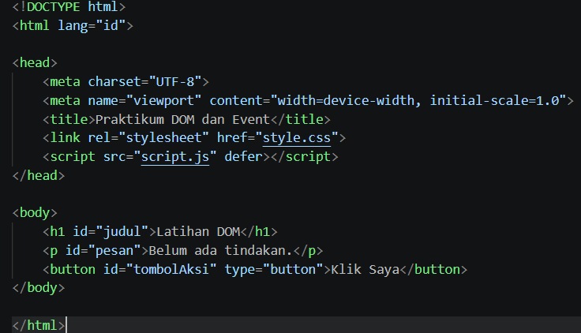

### 2. Manipulasi Konten Teks DOM Berdasarkan ID
- Memilih elemen HTML berdasarkan atribut ID menggunakan `document.getElementById()` lalu mengubah konten teksnya menggunakan properti `textContent`

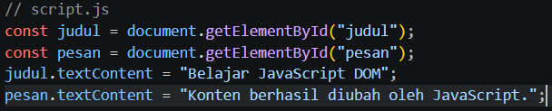
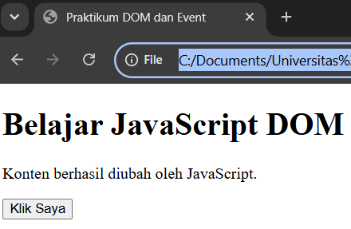
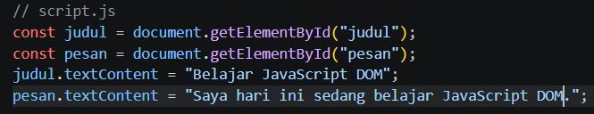
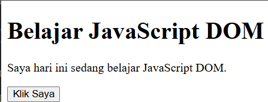

### 3. Penanganan Event Klik Tombol (`addEventListener`)
- Menambahkan *event listener* berjenis `"click"` pada elemen tombol untuk merespons tindakan pengguna secara dinamis

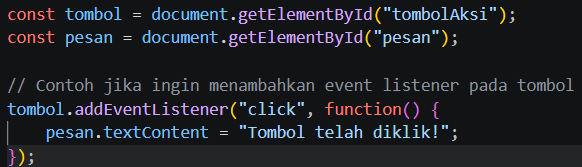
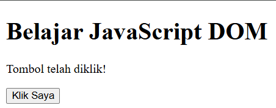

### 4. Pengubahan Gaya CSS Dinamis dengan `classList.toggle()`
- Menambahkan kelas aturan CSS `.highlight` dan `.teks-besar` pada berkas `style.css` lalu menerapkannya melalui `classList.toggle()`

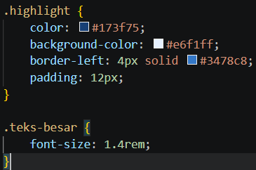
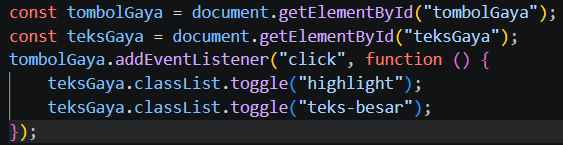
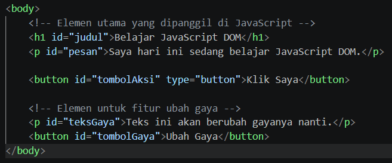
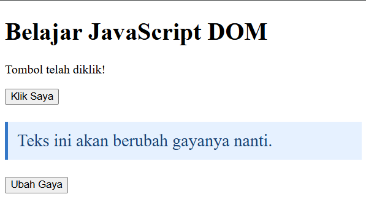

### 5. Penggunaan `classList.add()` dan `classList.remove()`
- Mempraktikkan penambahan dan penghapusan kelas gaya CSS secara eksplisit menggunakan method `classList.add()` dan `classList.remove()`

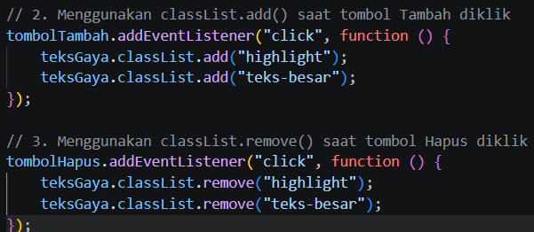
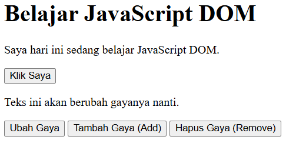

### 6. Penghitung Karakter Input Real-Time (`event input`)
- Membuat input teks nama dengan batasan maksimal karakter dan indikator penghitung dinamis yang diperbarui secara langsung saat pengguna mengetik

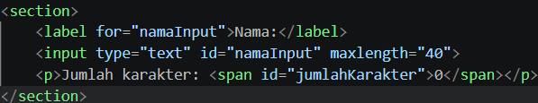
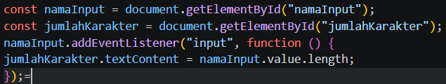
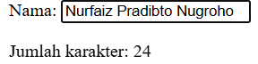
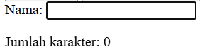
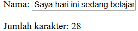

### 7. Validasi Form Pendaftaran dan Pencegahan Event Default
- Membuat formulir pendaftaran (Nama, Email, Usia) dengan validasi input berbasis percabangan serta menghentikan aksi bawaan browser menggunakan `event.preventDefault()`

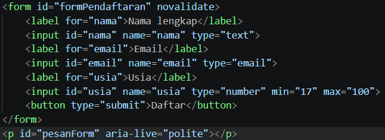
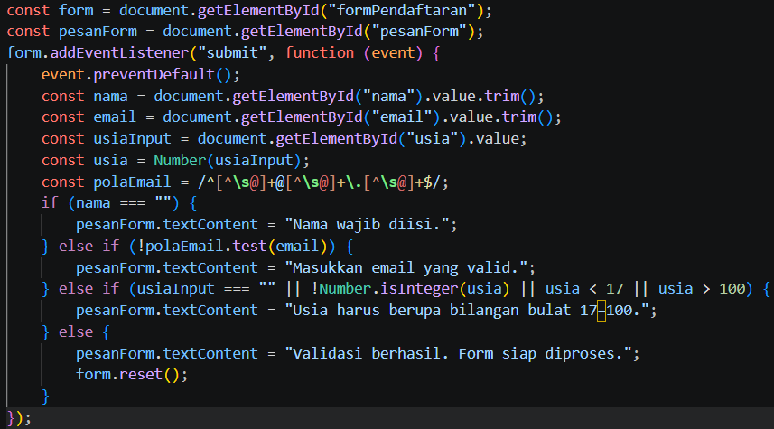
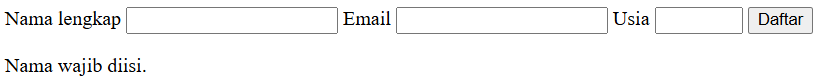
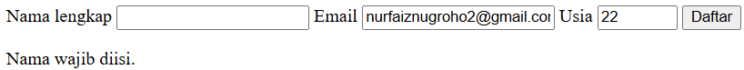
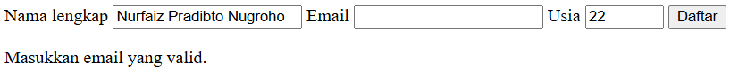
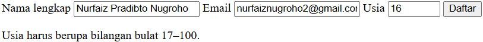
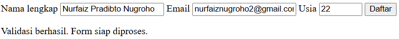

### 8. Aplikasi Sederhana Daftar Tugas (To-Do List)
- Membangun aplikasi daftar tugas dinamis menggunakan `document.createElement()`, penambahan elemen `<li>`, serta fitur penanda status selesai (*line-through*)

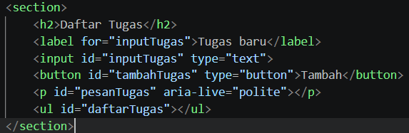
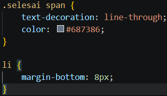
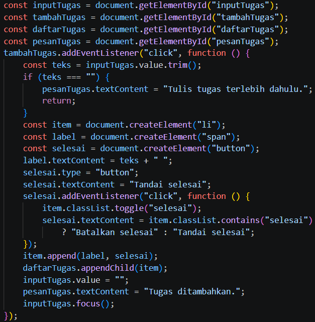
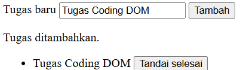
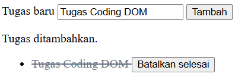

### 9. Pengembangan Halaman Pendaftaran Workshop Interaktif
- Mengembangkan halaman formulir pendaftaran workshop dengan minimal tiga fungsi interaktif (penghitung karakter, validasi data, pesan sukses/error dinamis, serta ringkasan pendaftaran)

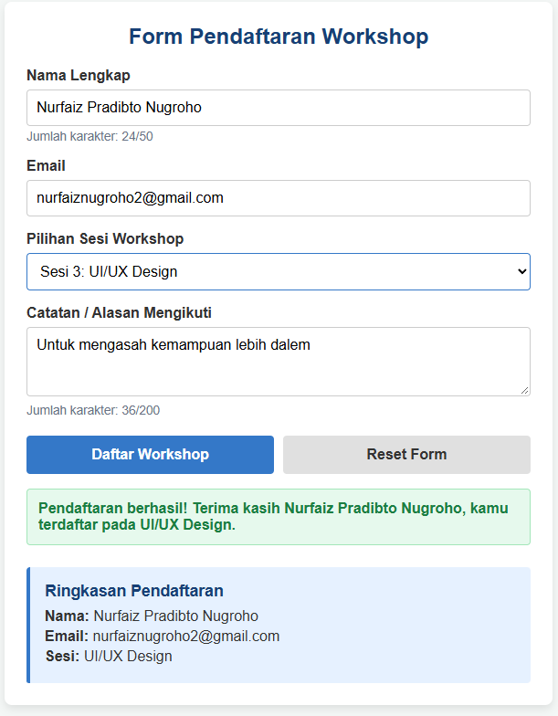
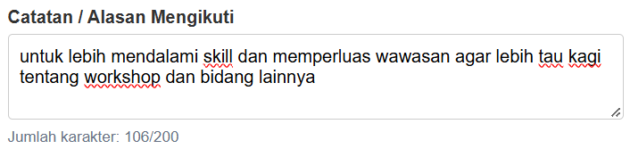
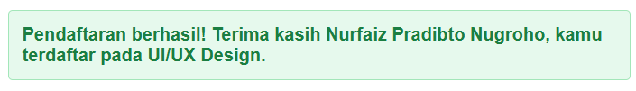
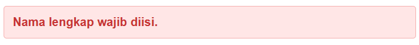
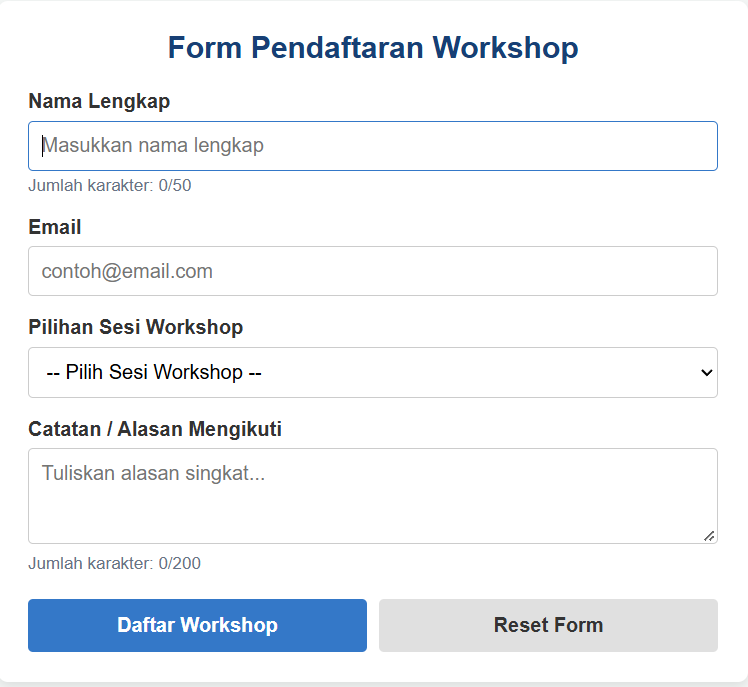

---

## Eksperimen Mandiri

### 1. Tombol Hapus Item pada To-Do List
- Menambahkan tombol hapus fungsional ke dalam komponen tugas untuk menghapus elemen `<li>` secara spesifik dari DOM menggunakan method `item.remove()`

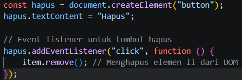
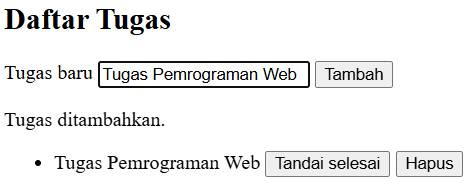

### 2. Validasi Panjang Minimal Karakter Nama
- Memodifikasi aturan validasi formulir agar kolom nama lengkap wajib diisi minimal tiga karakter (`nama.length < 3`)

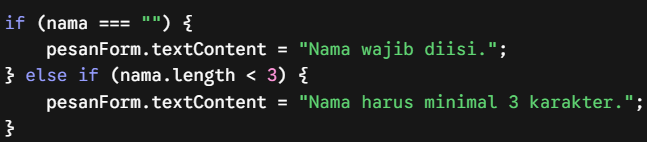
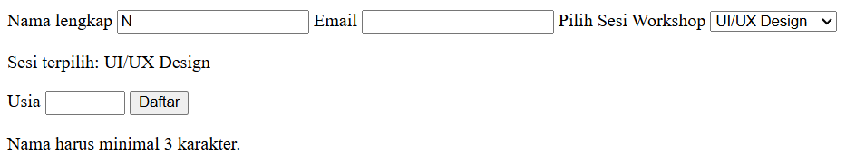

### 3. Event Change pada Dropdown Sesi Workshop
- Menambahkan *event listener* bertipe `"change"` pada elemen pilihan sesi workshop `<select>` guna mendeteksi perubahan pilihan dan memperbarui teks informasi secara langsung

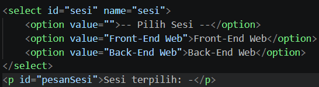
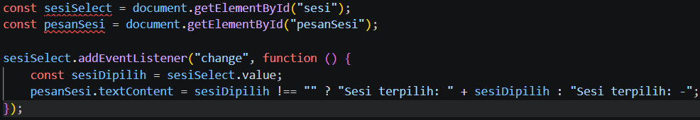

### 4. Toggle Sembunyikan dan Tampilkan Paragraf
- Membuat kelas CSS `.sembunyi { display: none; }` dan tombol interaktif untuk menyembunyikan serta menampilkan kembali elemen paragraf secara dinamis

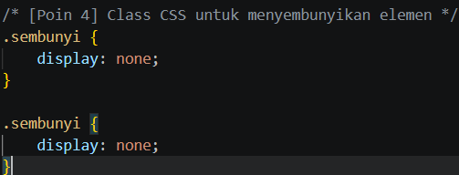
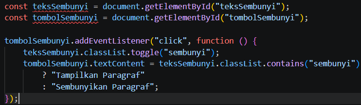
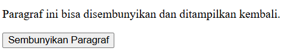
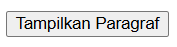

---

## Analisis Masalah: Penempatan Script Tanpa Atribut `defer` di dalam `<head>`

- **Kemungkinan Masalah yang Muncul:** Terdapat pesan kesalahan (*error*) pada konsol peramban seperti `Uncaught TypeError: Cannot read properties of null (reading 'addEventListener')`
- **Analisis Penyebab:** Peramban membaca dokumen HTML secara sinkron dari atas ke bawah. Apabila tag `<script>` diletakkan di dalam `<head>` tanpa atribut `defer`, berkas JavaScript akan dieksekusi sebelum elemen-elemen di dalam `<body>` selesai dimuat. Akibatnya, perintah seperti `document.getElementById()` mengembalikan nilai `null` karena elemen target belum terbentuk di DOM

---

## Pertanyaan dan Jawaban

1. **Apa yang dimaksud dengan DOM dan apa manfaatnya?**
   - **Pengertian:** DOM (*Document Object Model*) adalah antarmuka pemrograman yang merepresentasikan dokumen HTML/XML dalam bentuk struktur pohon (*tree structure*) sehingga dapat diakses dan dimanipulasi oleh bahasa pemrograman seperti JavaScript
   - **Manfaat:** Memungkinkan JavaScript untuk membaca, mengubah, menambah, atau menghapus elemen HTML, atribut, dan gaya CSS secara dinamis serta merespons interaksi pengguna (*event handling*) tanpa perlu memuat ulang (*reload*) halaman

2. **Apa perbedaan `getElementById()`, `querySelector()`, dan `querySelectorAll()`?**
   - `getElementById(id)`: Mencari dan mengambil satu elemen unik berdasarkan nilai atribut ID
   - `querySelector(selector)`: Mengambil elemen pertama yang cocok dengan pemilih CSS tertentu (ID, kelas, atau tag)
   - `querySelectorAll(selector)`: Mengambil seluruh elemen yang cocok dengan pemilih CSS dalam bentuk daftar objek (*NodeList*)

3. **Apa fungsi `addEventListener()` dan sebutkan tiga contoh event!**
   - **Fungsi:** Mendaftarkan fungsi penangan (*event handler*) pada suatu elemen agar mendengarkan dan merespons tindakan atau kejadian spesifik
   - **Tiga Contoh Event:** `"click"`, `"input"` (atau `"change"`), dan `"submit"`

4. **Mengapa `event.preventDefault()` digunakan pada event submit form?**
   - Berfungsi untuk mencegah tindakan bawaan browser (*default action*) berupa pemuatan ulang halaman (*reload*) atau pengiriman data langsung ke server, sehingga data dapat divalidasi secara lokal terlebih dahulu

5. **Apa perbedaan `textContent` dan `innerHTML` dari sisi penggunaan dan keamanan?**
   - **Sisi Penggunaan:** `textContent` digunakan untuk mengambil/mengubah teks murni tanpa memproses tag HTML, sedangkan `innerHTML` memproses teks beserta struktur tag HTML di dalamnya
   - **Sisi Keamanan:** `textContent` lebih aman karena memperlakukan semua input sebagai teks biasa (mencegah celah *Cross-Site Scripting* / XSS), sementara `innerHTML` rentan terhadap eksploitasi XSS jika bersumber dari masukan pengguna secara langsung

6. **Bagaimana `classList.toggle()` membantu mengubah tampilan elemen?**
   - Method ini memeriksa keberadaan kelas CSS: jika belum ada maka akan ditambahkan (*add*), dan jika sudah ada maka akan dihapus (*remove*). Sangat membantu untuk membuat efek saklar (*switch*) secara instan seperti mode gelap atau dropdown menu

7. **Sebutkan minimal tiga skenario pengujian validasi form!**
   - **Skenario Input Kosong:** Menguji form saat dikirimkan tanpa mengisi field wajib untuk memastikan pesan error muncul
   - **Skenario Format Data Tidak Valid:** Menguji input email tanpa karakter `@` atau titik untuk memastikan regex mendeteksi kesalahan
   - **Skenario Batas Nilai / Karakter:** Menguji input angka di luar rentang atau panjang karakter kurang dari batas minimum